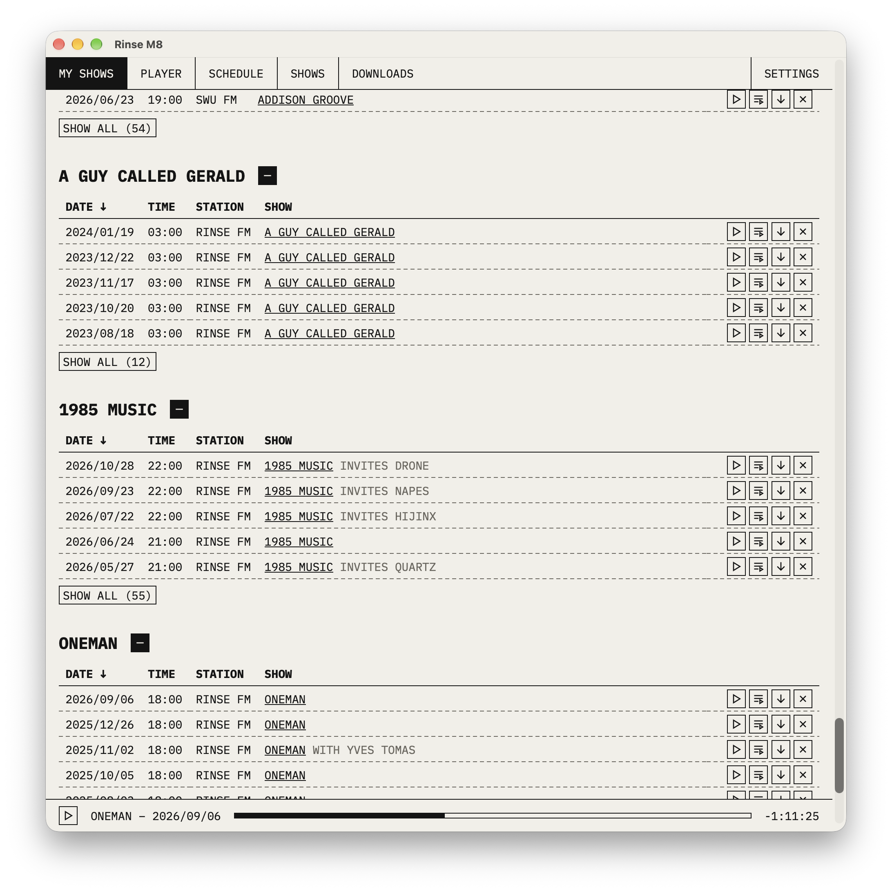

# Rinse M8

A desktop app for browsing, downloading and listening to on-demand episodes from the four stations at [rinse.fm](https://rinse.fm): Rinse FM, Rinse FR, Kool FM and SWU FM.



## Features

- Browse the schedule and the full show directory, with filters and sortable columns
- Subscribe to shows and follow their newest episodes on the dashboard
- Get notified of new episodes, and download them automatically if you like
- Download episodes through a resumable queue that survives restarts
- Listen with the built-in player, including a play queue and resume
- Scrobble to Last.fm
- Import and export subscriptions as JSON

## Installation

Download the latest version for macOS, Windows or Linux from the [releases page](https://github.com/idleberg/rinse-m8/releases/latest).

On macOS, you can also install it with Homebrew:

```sh
brew install --cask idleberg/asahi/rinse-m8
```

## License

This work is licensed under [The MIT License](LICENSE).
